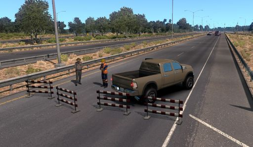
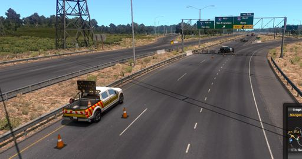

# Documentation/Engine/Detours



*Detour preview 1*



*Detour preview 2*

Detours (DE) are dynamically generated situations causing closure of a whole road.

DE are procedurally generated and do not need specific data definition for specific detours. Only data you need to provide are cutscenes for road closure, road blocks and for the detour cause event.

## How does it work?

There are several conditions which must be met to generate detour.

- Player must take an offline job.
- There must be enough time passed since the last detour.
- Job GPS route must contain suitable road for closure.

When player take an offline job, the game analyze the found GPS route and if it finds any valid detours, game chooses it. When there are multiple valid detours, the game chooses randomly one of them.

You may noticed that there is no mention of cutscenes. It is because the analyzation algorithm do not consider provided cutscenes for closure visualization (because of performance). Cutscene are generated when player approach the closure and only at this time the game search for correct cutscene.

## Data units

Similar to the road events, detours work with one master unit describing general behaviour of the feature and then with units describing closure and event visualization for different lanes and roads.

### Master data unit

There may be only one unit of this type. It is located in **/def/world/journey_detour_master.sii**

```
SiiNunit
{
journey_events_detour_data : .master
{
    min_game_time_delay:	2400		// 4 (hours) * 60 (hour2min) * 20 (map scale) / 2 (some time spend in city)
    max_game_time_delay:	4800		// 8 (hours) * 60 (hour2min) * 20 (map scale) / 2 (some time spend in city)
    minimal_level:              2
}
}
```

Properties:

- **min_game_time_delay** Minimal game time from the last detour. If the time from the last detour is lower than this property, detour will not be generated.
- **max_game_time_delay** Maximal game time from the last detour. If the time from the last detour is larger than this property, detour will be always generated. (if other conditions are also fulfilled)
- **minimal_level** Minimal level for detour generation.

Remaining case is when the time from the last detour is between **min_game_time_delay** and **max_game_time_delay**. In that case the detour will be generated with the probability corresponding to the uniform distribution of **one** detour between these times.

### Detour data unit

These unit define which cutscene will be used for which part of detour visualization.

Example of detour data unit located in **/def/world/journey_detours.sii**

```
journey_events_detour : j_dt.1_cl_ri1
{
	cutscene:		j_cut.1_cl_ri1
	lane_idx:		1
	lane_count:		1
	type:			road_block_right
}
```

Properties:

- **cutscene** Used cutscene. See below.
- **type** Type of visualization.
  - ***closed_road*** Source of the detour. This cutscene will be generated on the place of detour origin. (**4. car** (vehicles) on the Detour preview 2 image)
  - ***border_prefab_node*** These cutscenes will be generated between each closing prefab (prefab where the traffic is diverted) and closed road. (**3. car** on the Detour preview 2 image)
  - ***road_block_right*** These cutscenes will be generated on closed road lanes before the closing prefab. Traffic go round to the left.
  - ***road_block_left*** These cutscenes will be generated on closed road lanes before the closing prefab. Traffic go round to the right. (**1.** (*lane_idx* = 2) **car** and **2.** (*lane_idx* = 1) **car** on the Detour preview 2 image)
- **lane_count** Cutscenes will be generated only on the roads with this number of lanes.
- **lane_idx** Valid only for *road_block_* type. Cutscene will be generated for this road block only if the distance to the closest free lane is the same as this number.

### Cutscenes data unit

Because DE are part of the journey event framework, they use the same cutscene units as the random road events. You can see detailed description of the cutscene unit here: [Documentation/Engine/Random Road Events#Cutscenes_for_random_events](Random%20Road%20Events.md#Cutscenes_for_random_events)

<!-- source: https://modding.scssoft.com/wiki/Documentation/Engine/Detours | revision: 5312 | captured: 2026-10-21 23:56:14 -->
