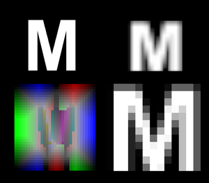

# Documentation/Engine/Fonts

This post describes changes made to the font generation and rendering system in 1.43.

## Intro



*SDF fonts (left) vs old raster fonts (right). Font quality on screen (top) vs internal texture representation (bottom).*

Up until now, all of our text rendering was done using plain raster fonts. While this approach could have been considered adequate years ago, in the days of 4K resolutions and high DPIs it no longer does the job fitting the requirements imposed by today's standards for modern games. The solution comes in the form of [signed distance fields](https://steamcdn-a.akamaihd.net/apps/valve/2007/SIGGRAPH2007_AlphaTestedMagnification.pdf). Instead of storing straight raster information like we would in an image, the texture encodes distance to the nearest edge, effectively allowing us to approximate the actual shape of the glyph when rendering. The main benefit of this technique is that the glyph becomes in theory infinitely scalable, while also allowing us to apply consistent anti-aliasing regardless of size on-screen. It also allows allows us to apply a multitude of effe/cts at runtime, such as outlines or glow.

While the resulting individually generated atlases can be larger in size, we only have to generate them once to cover all the possible font sizes. For example, in cases of ATS/ETS2, we no longer need multiple texture sets for the **normal**, **normal_o**, **title**, **big**, **small** base fonts, since they are all based on the same source TTF file. Additionally, we can also use this to create multiple effect variations of the same font at virtually no additional cost.

## Sii Definitions

The new font definition format is based on the old one. While new parameters have been added, old definitions remain mostly compatible with the [new generator](https://modding.scssoft.com/index.php?title=Documentation/Tools/fontgen/Download&action=edit&redlink=1).

Notable changes:

- Size of glyphs in the texture itself no longer has any relationship to how big the text is on screen. They should be as big as required to encode enough detail without artifacting at all sizes we expect to see on screen. As such, the **width** and **height** parameters have been replaced with a single **size** parameter, while **scale_width**, **scale_height** remain and are used to add additional per-atlas scaling when rendering. Note that we now store per-atlas sizing information in all generated fonts, so as far as text sizing goes, everything should appear the way you expect it to on-screen.
- A new optional **texture_size** parameter can be used to directly specify the size of the generated texture to increase/decrease quality of the text. By default, this is chosen automatically by the generator based on the requested size specifications; however, if you feel like the result doesn't look good enough, you can manually use this parameter to force the generator to create a larger texture. You can also make the texture smaller to save storage, provided the impact on visual quality is negligible.
- The generator now supports OTF fonts as well.

```
texture_size: (256, 256) # Force the generator to create a 256x256 texture for this atlas.
```

> **Note:** Tip: To reach the best size/quality ratio, you should start with a small texture size and increase it until the font reaches the desired quality.

- An optional **sdf_range** parameter specifies the size of the distance field, which needs to be big enough to allow us to properly render edge-based effects such as antialiasing, soft shadows, outlines etc. The generator calculates this automatically based on requirements. The only time you may need to specify it yourself is when using atlases shared accross multiple fonts - child font may use effects incompatible with the SDF range provided by the parent font, in which case the generator will tell you the size the minimum SDF range the parent font needs to use to accommodate. Note that increasing SDF range reduces quality as less data can be used to encode fine details, so you may have to specify a larger texture size to compensate.
- **antialias**/**gradient** parameters have been removed, as they are either no longer needed or weren't used at all.

An example of a font definition using a single atlas:

```
SiiNunit
{
configuration : .cfg
{
	base: "../../base"
	output: "/font/normal"
	char_config[]: .cfg0
    line_spacing: 2
    vertical_span_bias: 1
    include_escaped_charset: false
}

char_set_config : .cfg0
{
    # Base atlas parameters based on the old format
  	font_file:"papyrus_regular.ttf"
  	character_set_file: "charset.txt"
  	size: 38              # EM size
	scale_width: 1.0        # X-scaling factor (applied when rendering)
	scale_height: 1.0       # Y-scaling factor (applied when rendering)

	# Optional: base color
    base_color: (1.0, 0.0, 0.0, 1.0)    # default is (1, 1, 1, 1)

	# Optional: kerning bias
	kerning_bias: 2         # glyph kerning bias (px) at full scale

	# Optional: thickness bias
	thickness_bias: 1       # glyph thickness_bias (px) at full scale

	# Optional: outline parameters
    outline_width: 1        # outline width (px) at full scale
    outline_color: (0.0, 0.5, 0.0, 1.0) # default is (0, 0, 0, 1)

    # Optional: drop shadow parameters
    shadow_angle: -45       # shadow angle in degrees
	shadow_distance: 2.0    # shadow distance (px) at full scale
	shadow_alpha: 0.4       # shadow alpha (0-1)
	shadow_size: 2          # shadow size (px) at full scale (0 - hard shadow, >0 - softer, spread out shadow)

    # Optional: glow parameters
    glow_color: (0.0, 1.0, 0.0)
    glow_size: 5            # glow size (px) at full scale

    # Optional: bevel parameters
    bevel_angle: -45        # bevel angle in degrees (should be same as shadow for consistent lighting)
    bevel_alpha: 0.5        # bevel alpha (0-1)
    bevel_size: 1.5         # bevel size (px) at full scale

    # Optional: additional MSDFGen parameters
    # Expert-only, see \etc\font\msdf-atlas-gen.exe -help for more info.
    additional_msdfgen_parameters: "-errorcorrection full-auto"
}

}
```

#### Cutting corners

By default, we use three colour channels to encode distance field infomation (a method known as MSDF). This allows us to preserve hard corners, at the cost of increased storage requirements.

If you don't need sharp corners and/or need to cut filesize down, you can use the following parameter in your atlas definition:

```
sharp_corners: false
```

> **Note:** If you're using a font that's rounded in the first place, you should also consider doing this.

This will result in a 66% decrease in memory requirements, at the cost of everything looking a bit more rounded. Note that this also allows you to use a larger texture size while still saving some memory; we currently employ this in CJK fonts where sharp corners aren't a must.

### Atlas Sharing

**normal.sii:**

```
SiiNunit
{
configuration : normal.cfg # parent font configuration can't be nameless!
{
	base: "../../base"
	output: "/font/normal"
	char_config[]: .cfg0
	char_config[]: .cfg1
	char_config[]: .cfg2
	char_config[]: .cfg3
	char_config[]: .cfg4
	char_config[]: .cfg5
	line_spacing: 0
	default_scale: 0.83
	include_escaped_charset: true
}

char_set_config : .cfg0
{
  	font_file:"arialbd.ttf"
  	character_set_file: "charset.txt"

	scale_width: 0.96
	size: 17
	scale_height: 0.96
    texture_size: (1024, 512)
    sdf_range: 8
}

...
```

**normal_o.sii:**

```
SiiNunit
{
configuration : .cfg
{
	base: "../../base"
	output: "/font/normal_o"
	char_config[]: .cfg0
	char_config[]: .cfg1
	char_config[]: .cfg2
	char_config[]: .cfg3
	char_config[]: .cfg4
    char_config[]: .cfg5 # number of atlases needs to match!
	line_spacing: 0
    atlas_source: "./normal.sii"
}

char_set_config : .cfg0
{
    # source ttf and charset data automatically pulled from normal.sii
	size: 14
	scale_width: 1.0
	scale_height: 1.0
	outline_width: 2
}

...
```

<!-- source: https://modding.scssoft.com/wiki/Documentation/Engine/Fonts | revision: 5026 | captured: 2026-10-21 23:56:14 -->
