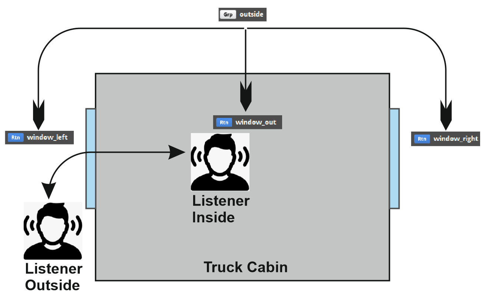

# Documentation/Engine/Sound/TruckCabinFiltering

## 卡车驾驶室的滤波

卡车驾驶室可以按卡车单独进行声音滤波。*（1.43 版本新增）*  （*自 1.43 版本起，主 bank 中硬编码的均衡器设置（自动化）已被移除。*）

## 声音处理

处理驾驶室声音时，以下特性很重要：

**听者位置（内部 / 外部）**

- 该状态由全局参数 *cabin_out* 控制（0 表示内部，1 表示外部）。

**车窗开闭状态（关闭 / 打开）**

- 该状态由全局参数 *wnd_left*、*wnd_right* 控制（0 表示关闭，1 表示打开）。

**声音处理**

- 1. 通常，声音会相对于听者的位置按外部声音处理。处理结果位于音频总线 [**Grp outside**] 中。
- 2. 随后，该通道被重定向（分割）到三个音频总线：
  - [**Rtn window_out**] 驾驶室内中央的声音溢出。
  - [**Rtn window_left**] 使声音穿过左侧车窗。
  - [**Rtn window_right**] 使声音穿过右侧车窗。
- 3. 最后，这三个总线被混合为最终声音。

## 调节音量

音量设置硬编码在 FMOD 主 bank 中，但理解它对于后续处理是必要的。

音量根据听者的位置进行控制，并影响已处理音频总线的最终混合结果：

| 音频总线 | 听者在内部 | 听者在外部 |
| --- | --- | --- |
| [**Rtn window_out**] | -6 dB | +4 dB |
| [**Rtn window_left**] | -7 dB | *静音* |
| [**Rtn window_right**] | -7 dB | *静音* |

## 车窗打开/关闭时的声音衰减

声音衰减由均衡器（3-EQ）控制，该均衡器位于每个处理声音通过车窗的声音总线上。均衡器设置按卡车单独配置（自 1.43 版本起），并且是内饰声音设置的一部分。

| 车窗 | 音频总线 | 打开 | 关闭 |
| --- | --- | --- | --- |
| 左侧 | [**Rtn window_left**] | .effect.add.window_eq.opened | .effect.add.window_eq.closed |
| 右侧 | [**Rtn window_right**] | .effect.add.window_eq.opened | .effect.add.window_eq.closed |

均衡器极限参数之间的过渡由应用程序进行线性近似。在同一均衡器上为 low_crossover、high_crossover 参数设置差异很大的边界时请务必小心。较大的差异可能产生不期望的声音模式。

## 取决于听者位置的声音衰减

声音衰减由均衡器（3-EQ）控制，该均衡器位于 [**Rtn window_out**] 音频总线上。均衡器设置按卡车单独配置（自 1.43 版本起），并且是内饰声音设置的一部分。

| 听者 | 音频总线 | 内部 | 外部 |
| --- | --- | --- | --- |
| 听者 | [**Rtn window_out**] | .effect.equalizer.cabin.inside | .effect.equalizer.cabin.outside |

均衡器极限参数之间的过渡由应用程序进行线性近似。在同一均衡器上为 low_crossover、high_crossover 参数设置差异很大的边界时请务必小心。较大的差异可能产生不期望的声音模式。

## 驾驶室内的混响

驾驶室内的混响同时取决于听者的位置以及车窗打开/关闭的状态。混响设置仅在所有三个音频总线的最终混音上处理。（*在声音 bank 内，Reverb 效果位于 [Grp cabin] 音频总线上。*）

混响设置按卡车单独配置（自 1.43 版本起），并且是内饰声音设置的一部分。

| 混响 | 音频总线 | 内部 | 外部 |
| --- | --- | --- | --- |
| 混响效果 | [**Grp cabin**] | .effect.reverb.window.closed | .effect.reverb.window.opened |

混响极限参数之间的过渡由应用程序进行线性近似。外部混响应大致对应外部（开阔）环境。因此，我们建议采用不会使回声变化过大的设置。

<!-- source: https://modding.scssoft.com/wiki/Documentation/Engine/Sound/TruckCabinFiltering | revision: 5163 | captured: 2026-10-21 23:56:14 -->
