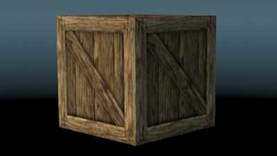
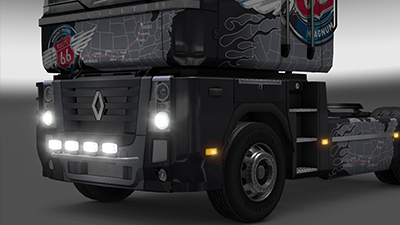
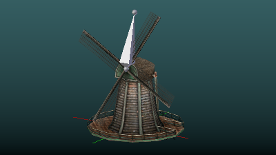

# Tutorials

Here you will find a set of tutorials that you can use to learn how to make and maintain mods for SCS games.

This page is organised in different ways for better navigation through the tutorials. If you are a complete beginner and you don't have the slightest idea of what you should be doing then the All In One section is right for you. For the rest, there are additional sections dividing tutorials by categories leading you straight to the tutorial you need.

## [Beginners](Tutorials/Beginners.md)

Tutorials giving you complete solutions of mod creation from start to the complete packed mod ready for usage and distribution.

|  |
| --- |
| [Simple cube](Tutorials/Beginners/Simple%20cube.md) |
|  |
| Steps: [How to prepare tools for mod creation](Tutorials/Beginners/Simple%20cube/1.%20How%20to%20prepare%20tools%20for%20mod%20creation.md) [How to create & export simple cube model](Tutorials/Beginners/Simple%20cube/2.%20How%20to%20create%20&%20export%20simple%20cube%20model.md) [How to configure cube as map asset model](Tutorials/Beginners/Simple%20cube/3.%20How%20to%20configure%20cube%20as%20map%20asset%20model.md) [How to convert & pack a mod](Tutorials/Beginners/Simple%20cube/4.%20How%20to%20convert%20&%20pack%20a%20mod.md) [How to use simple cube mod in map editor](Tutorials/Beginners/Simple%20cube/5.%20How%20to%20use%20simple%20cube%20mod%20in%20map%20editor.md) |

|  |
| --- |
| [Truck accessory](Tutorials/Beginners/Truck%20accessory.md) |
|  |
| Steps: [How to configure new truck accessory mod](Tutorials/Beginners/Truck%20accessory/1.%20How%20to%20configure%20new%20truck%20accessory%20mod.md) [How to create model of front grill accessory](Tutorials/Beginners/Truck%20accessory/2.%20How%20to%20create%20model%20of%20front%20grill%20accessory.md) [How to use your truck accessory mod in game & tweak it](Tutorials/Beginners/Truck%20accessory/3.%20How%20to%20use%20truck%20accessory%20mod%20in%20game%20&%20tweak%20it.md) |

## [Advanced](Tutorials/Advanced.md)

Tutorials with more complicated configuration and/or bigger mod scope. These tutorials do not show you the whole procedure of mod creation, rather they provide a solution to a specific problem.

|  |
| --- |
| [First animation model](Tutorials/Advanced/First%20animation%20model.md) |
|  |
| Steps: [Create & export first animation model](Tutorials/Advanced/First%20animation%20model.md#1._Create_&_export_first_animation_model) [Use animation model as mover in game](Tutorials/Advanced/First%20animation%20model.md#2._Use_animation_model_as_mover_in_game) |

## Tutorials per tools

Tutorials for specific SCS tools.

#### [SCS Workshop Uploader](Tutorials/SCS%20Workshop%20Uploader.md)

- [How to download the tool?](Tutorials/SCS%20Workshop%20Uploader/How%20to%20download%20the%20tool_.md)
- [How to update workshop mod?](Tutorials/SCS%20Workshop%20Uploader/How%20to%20update%20workshop%20mod_.md)
- [How to upload new mod?](Tutorials/SCS%20Workshop%20Uploader/How%20to%20upload%20new%20mod_.md)
- [How to use mod versioning](Tutorials/SCS%20Workshop%20Uploader/How%20to%20use%20mod%20versioning.md)

#### [Map Editor](Tutorials/Map%20Editor.md)

- [Introduction to the Map Editor](Tutorials/Map%20Editor/Introduction%20to%20the%20Map%20Editor.md)
- [Introduction to the Map Editor/Basic Editor Functions](Tutorials/Map%20Editor/Introduction%20to%20the%20Map%20Editor/Basic%20Editor%20Functions.md)
- [Introduction to the Map Editor/Launching the Map Editor](Tutorials/Map%20Editor/Introduction%20to%20the%20Map%20Editor/Launching%20the%20Map%20Editor.md)
- [Introduction to the Map Editor/Saving, Loading, Sectors, and Files](Tutorials/Map%20Editor/Introduction%20to%20the%20Map%20Editor/Saving,%20Loading,%20Sectors,%20and%20Files.md)
- [Prefabs](Tutorials/Map%20Editor/Prefabs.md)
- [Prefabs/Connecting your first Prefab](Tutorials/Map%20Editor/Prefabs/Connecting%20your%20first%20Prefab.md)
- [Prefabs/Prefab Nodes](Tutorials/Map%20Editor/Prefabs/Prefab%20Nodes.md)
- [Roads](Tutorials/Map%20Editor/Roads.md)
- [Roads/Advanced Road Construction](Tutorials/Map%20Editor/Roads/Advanced%20Road%20Construction.md)
- [Roads/Creating a Simple Road](Tutorials/Map%20Editor/Roads/Creating%20a%20Simple%20Road.md)
- [Roads/Road Item Default Properties Dialog](Tutorials/Map%20Editor/Roads/Road%20Item%20Default%20Properties%20Dialog.md)
- [Roads/Road Item Properties Dialog](Tutorials/Map%20Editor/Roads/Road%20Item%20Properties%20Dialog.md)
- [Roads/Road Node Manipulation](Tutorials/Map%20Editor/Roads/Road%20Node%20Manipulation.md)

<!-- source: https://modding.scssoft.com/wiki/Tutorials | revision: 5280 | captured: 2026-10-21 23:56:14 -->
